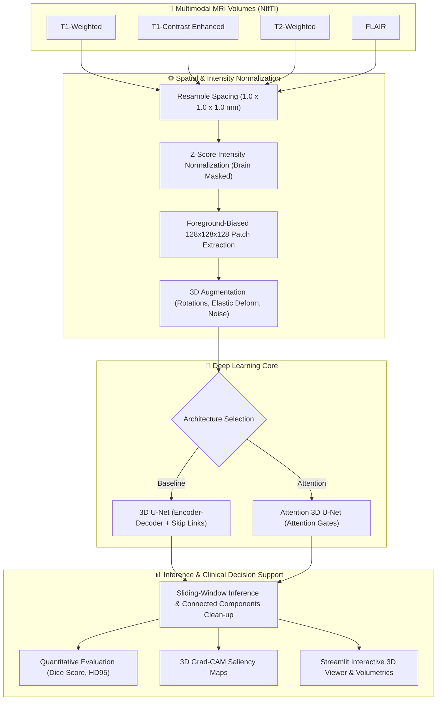

# 🧠 Multimodal 3D Brain Tumor Segmentation from MRI (BraTS)

<div align="center">

[](https://www.python.org/)
[](https://pytorch.org/)
[](https://monai.io/)
[](https://nipy.org/nibabel/)
[](https://streamlit.io/)
[](http://braintumorsegmentation.org/)
[](LICENSE)

**An end-to-end, production-ready deep learning pipeline for automated glioma segmentation from 3D multimodal MRI scans (T1, T1ce, T2, FLAIR) using 3D U-Net and Attention 3D U-Net with Grad-CAM explainability and interactive Streamlit deployment.**

[Overview](#-project-overview) • [Architecture](#%EF%B8%8F-system-architecture) • [Clinical Labels](#-data-schema--labels) • [Quick Start](#-installation--setup) • [Web Application](#-running-the-web-interface) • [Evaluation](#-evaluation--testing) • [Explainability](#-explainability-grad-cam)

</div>

---

## 🧠 Project Overview

Brain tumors (specifically high-grade and low-grade gliomas) are among the most aggressive central nervous system neoplasms. Manual delineation of tumor margins across volumetric MRI is time-consuming (30–60 minutes per patient), subjective, and prone to inter-observer variability.

This repository provides an automated, clinician-friendly pipeline that fuses **4 complementary MRI modalities** into a unified 4-channel 3D volume to segment three nested sub-regions with voxel-level precision:
1. **Whole Tumor (WT)**: Complete extent of pathology, including peritumoral vasogenic edema.
2. **Tumor Core (TC)**: Resection target containing necrosis, non-enhancing tumor, and active enhancing structures.
3. **Enhancing Tumor (ET)**: Actively proliferating, hyper-vascularized rim.

---

## 🏗️ System Architecture



---

## 🏷️ Data Schema & Labels

The pipeline maps raw multi-class voxel annotations into standard BraTS clinical sub-regions:

| BraTS Raw Label | Description | Segmented Sub-Region Included In |
|:---:|---|---|
| **Label 1** | Necrotic Core & Non-Enhancing Tumor (NCR/NET) | **Tumor Core (TC)** & **Whole Tumor (WT)** |
| **Label 2** | Peritumoral Edema (ED) | **Whole Tumor (WT)** |
| **Label 4** | Enhancing Tumor (ET) | **Enhancing Tumor (ET)**, **TC**, and **WT** |

$$\text{Whole Tumor (WT)} = \text{Label } 1 + 2 + 4$$
$$\text{Tumor Core (TC)} = \text{Label } 1 + 4$$
$$\text{Enhancing Tumor (ET)} = \text{Label } 4$$

---

## 🛠️ Technology Stack

- **Core Deep Learning**: [PyTorch 2.1+](https://pytorch.org/) with CUDA acceleration & Automatic Mixed Precision (AMP).
- **Medical Imaging Toolchain**: [MONAI](https://monai.io/), [NiBabel](https://nipy.org/nibabel/), [SimpleITK](https://simpleitk.org/).
- **Scientific Computing**: NumPy, SciPy, Scikit-learn, Scikit-image.
- **Diagnostics & Visualization**: TensorBoard, Matplotlib, Plotly, OpenCV.
- **Clinician Frontend**: [Streamlit](https://streamlit.io/) with multi-planar slice inspection (Axial, Coronal, Sagittal).

---

## 🚀 Installation & Setup

### 1. Environment Configuration

```bash
# Clone the repository
git clone https://github.com/Rahim36712/Brain-Tumor-Segmentation-3D.git
cd Brain-Tumor-Segmentation-3D

# Create virtual environment
python -m venv venv
# Linux/macOS:
source venv/bin/activate
# Windows:
venv\Scripts\activate

# Install PyTorch with CUDA (e.g., CUDA 12.1)
pip install torch torchvision --index-url https://download.pytorch.org/whl/cu121

# Install medical imaging dependencies
pip install -r requirements.txt
```

### 2. Dataset Hierarchy
Organize your dataset under `data/raw/` in standard BraTS format:
```
data/
└── raw/
    └── BraTS2021_Training/
        ├── BraTS2021_00000/
        │   ├── BraTS2021_00000_flair.nii.gz
        │   ├── BraTS2021_00000_seg.nii.gz
        │   ├── BraTS2021_00000_t1.nii.gz
        │   ├── BraTS2021_00000_t1ce.nii.gz
        │   └── BraTS2021_00000_t2.nii.gz
        └── ...
```

---

## 🏃 Running the Application

### 1. Generate Synthetic Test Data
If you do not have the raw BraTS files downloaded, you can generate synthetic 3D MRI volumes to test the complete pipeline:
```bash
python generate_demo_data.py
```
This writes a test subject `BraTS2021_DEMO_00000` to `data/raw/BraTS2021_Training/`.

### 2. Launch Training Pipeline
```bash
python training/train.py \
    --data_dir data/raw/BraTS2021_Training \
    --model attention_unet3d \
    --epochs 300 \
    --batch_size 2
```
To monitor real-time loss curves and training metrics:
```bash
tensorboard --logdir logs/
```

### 3. Launch Interactive Streamlit Web UI
```bash
streamlit run app/streamlit_app.py
```
- **Step 1**: Select your desired neural network (`3D U-Net` or `Attention 3D U-Net`).
- **Step 2**: Drag-and-drop or upload the 4 NIfTI modal files (`t1`, `t1ce`, `t2`, `flair`).
- **Step 3**: Click **"Run Segmentation"** to view interactive overlay slices across Axial, Coronal, and Sagittal planes with volumetric statistics.

---

## 📈 Evaluation & Testing

Evaluate model checkpoints against a test cohort with Dice similarity coefficient (DSC) and 95% Hausdorff Distance (HD95):
```bash
python evaluation/evaluate.py \
    --checkpoint checkpoints/best_model.pth \
    --data_dir data/raw/BraTS2021_Training \
    --hausdorff
```
Detailed per-case performance is exported to `outputs/evaluation_results.csv`.

---

## 🔍 Explainability (3D Grad-CAM)

Deep learning networks in clinical domains must be interpretable. This repository implements **volumetric 3D Grad-CAM**, calculating activation gradients across encoder bottleneck layers to visually explain which spatial regions drove the model's tumor boundary decisions:
```bash
python evaluation/gradcam.py \
    --checkpoint checkpoints/best_model.pth \
    --data_dir data/raw/BraTS2021_Training
```

---

## 📁 Repository Structure

```
Brain-Tumor-Segmentation-3D/
├── app/                      # Streamlit interactive web dashboard
│   └── streamlit_app.py
├── checkpoints/              # Saved model weights (.pth)
├── config.py                 # Hyperparameter, loss & path configuration
├── data/                     # Data storage (raw, processed & demo)
├── evaluation/               # Dice, HD95 metrics & Grad-CAM visualizer
│   ├── evaluate.py
│   └── gradcam.py
├── generate_demo_data.py     # Synthetic 3D NIfTI generator
├── inference/                # Sliding-window predictor & post-processing
│   └── predict.py
├── models/                   # 3D U-Net & Attention 3D U-Net architectures
│   ├── unet3d.py
│   └── attention_unet3d.py
├── preprocessing/            # Resampling, Z-score normalization & patch cropping
│   ├── augmentation.py
│   ├── patch_extraction.py
│   └── transforms.py
├── training/                 # AMP-enabled training loops & loss functions
│   ├── losses.py
│   └── train.py
├── requirements.txt          # Pinned Python dependencies
└── README.md                 # Project documentation
```

---

<div align="center">
  <sub>Deep Learning for Medical Image Computing — Precision, Transparency, Reliability.</sub>
</div>
